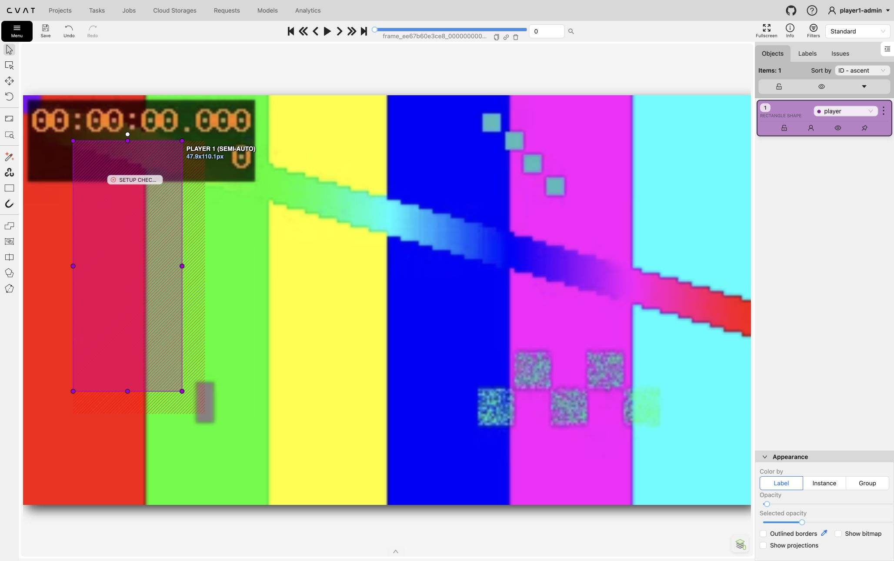
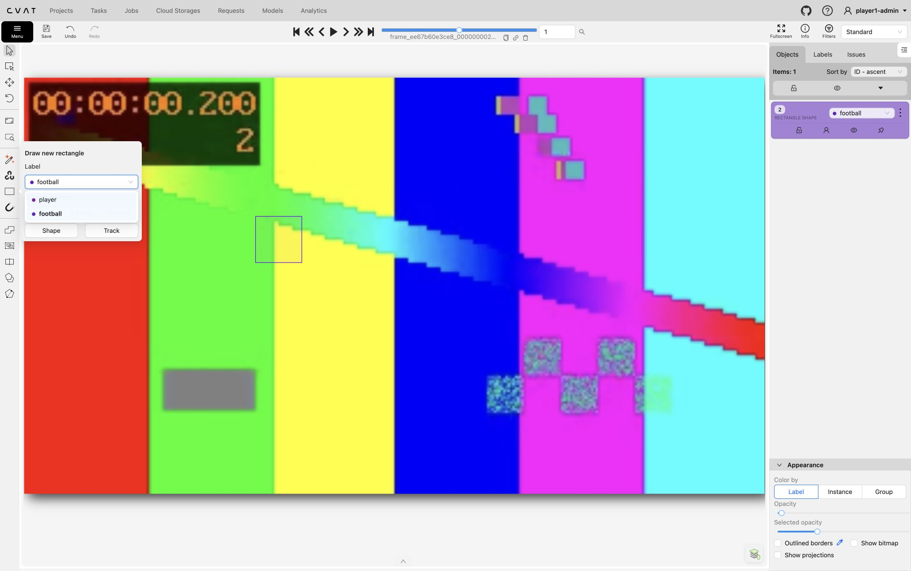
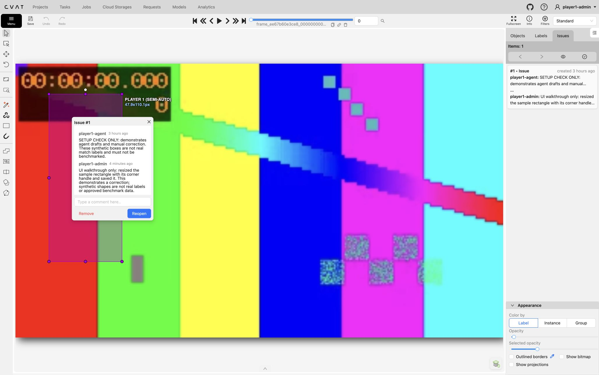

# Player 1 CVAT reviewer guide

For the new multi-person Frame 2 collection, use the [team plan](frame-two-labelling-plan.md) and [copyable AI prompt](team-labelling-prompt.md). The plan proposes sampled-frame jobs, a human check of every image, separate match splits and shared hosting. Its hosting and automation recommendations have not been deployed; the localhost instructions below still describe the existing pilot.

For the full-video goal markings and event tags in task 4, use the [goal-review guide](goal-review.md), including replay windows, decision fields and geometry corrections. The detector-box workflow below still applies to tasks 2/3.


Use this guide to check and correct the AI assistant's proposed labels in CVAT, our browser tool for image annotation. The reviewed labels become the answer key for comparing YOLO26n and D-FINE-N. Accurate, complete review matters: a missed person or ball can make a detector's correct prediction look wrong.

You do not need to run Python, install an MCP connector or operate the benchmark to review labels. The assistant prepares drafts and flags questions; you inspect the images, amend the boxes and record what you checked. A dataset coordinator manages access, assignments, unresolved cases and export. Agree who is coordinating your batch before starting.

These instructions match our CVAT 2.80.0 installation and the sample walkthrough of 25 October 2026.

**Latest review, 30 October:** the [ball-only re-review](labelling.md#ball-only-re-review-draft) in [task 3/job 3](http://localhost:8080/tasks/3/jobs/3) is complete. After revision 2, the user identified the ball behind the net at frame 35 (7:00); source context confirmed it and the assistant added one rectangle under the user's instruction to resolve it. Task 3 now corresponds to **revision 3: 493 people and 76 balls (34 playing, 42 spare)**. All previous rectangles and frozen revisions are preserved. All review issues are resolved. See the [correction record](crop-experiment-2026-10-30.md). Task 2 remains revision 1. Later corrections need another documented revision; coordinate them before editing either scored task. The instructions below apply to new review assignments.

## Get access and find your job

1. Ask the coordinator for your login, assigned job link and frame range. Use your own reviewer account when one is provided; do not use the agent's account or copy credentials into review notes.
2. On the Mac hosting CVAT, open [CVAT](http://localhost:8080). **This address is local to that Mac.** Opening `localhost:8080` on another computer will not reach this installation. A remote teammate needs access arranged by the coordinator first.
3. Open your assigned job. The current [Player 1 project](http://localhost:8080/projects/1) contains the [synthetic practice job](http://localhost:8080/tasks/1/jobs/1). Real footage will have its own assigned task/job.
4. Confirm that the assistant or another reviewer is not editing the same job while you work. Tell the coordinator when you start and when you hand it back.

Docker/OrbStack must be running on the host. If the site is unavailable, ask the maintainer to follow the [start and stop instructions](labelling.md#local-installation). Reviewers should not reinstall CVAT or reset its data.

CVAT uses these terms:

| Term | Meaning here |
|---|---|
| Project | Groups tasks that share the `player` and `football` labels. |
| Task | A collection of exported images to annotate. |
| Job | The assigned portion of a task that you open in the editor. |
| Frame | One uploaded image. CVAT numbers start at zero and differ from the original video's frame numbers. |
| Shape | A rectangle describing one visible object in one image. |
| Issue | A question attached to a frame and region, with a discussion and resolution state. |

## Practise before reviewing footage

The practice job contains test patterns, not football footage. Frame **0** has a pretend `player` box, frame **1** a pretend `football` box, and frame **2** has no boxes. Its annotations must never enter a benchmark.

Use it to practise resizing a rectangle, adding and removing a temporary box, saving, and reopening/resolving the sample issue. These are exercises in using the controls, not examples of correct object boundaries.

At the top right, choose **Standard** to edit boxes. **Review** mode locks them. Use **Fullscreen** if the browser panel hides the right sidebar. Navigate with the frame arrows or type a frame number in the top field and press Enter.

## What to label

Use only these two labels and ordinary, unrotated rectangles:

| Label | Include | Do not infer |
|---|---|---|
| `player` | Every visible person within the agreed match area, including any referee/substitute/spectator inside it. | Identity, team membership, people outside the selected region, or a fully hidden body. The class still means COCO person. |
| `football` | Every visible sports ball within the agreed match area. | Balls on another pitch outside the region, fully hidden/off-screen balls, or indistinguishable patches. |

Draw a tight box around the **visible extent** of each object. Clip it at the image boundary if the object is partly outside the image. For an occluded person, box the visible parts consistently rather than extending the box to an imagined full body. For blur, include the discernible extent; flag an ambiguous patch rather than confidently calling it a ball.

Use zoom and adjacent images for context when needed, but put the box at the object's visible position in the current image. Sampled images can be far apart in time. Do not add tracks, rotated boxes, object polygons, groups, ignore flags or extra classes for this benchmark.

The current real pilot excludes the other pitch across the top. Check the private handover's proposed boundary before reviewing. A person belongs to the region when their box's bottom-centre is inside; a ball uses its centre. Keep the whole visible box even when part extends past the boundary. The coordinator retains this separate polygon and uses it to exclude background predictions from both models. Do not draw it as another object in CVAT. A fixed region does not identify the 12 roster members. Bags/equipment on the near-goal net were mistakenly drafted as a person and have been removed; do not recreate that false person label. Nearby real players still need boxes. Legacy tasks without a region use full-image labels. See [scope rules](benchmarking.md#main-game-scope).

## Review and amend each frame

First scan the **whole image**, then inspect the proposed boxes. Starting only from existing boxes or flagged issues can hide objects the assistant missed.

| Action | Controls |
|---|---|
| Resize a box | In Standard, select the rectangle and drag its corner handles. Keep it aligned with the visible object. |
| Correct the class | In **Objects**, use the label dropdown in that rectangle's card. |
| Add a missed object | Choose **Rectangle** on the left toolbar, select the label, choose **2 Points**, then **Shape**. Click opposite corners of the object. |
| Remove a false or duplicate box | Open that object's **⋮** menu and choose **Remove**. |
| Recover an accidental edit | Use **Undo**; **Redo** repeats it. Check the result before saving. |
| Save changes | Click **Save** at the top left, or press **Cmd+S** on Mac / **Ctrl+S** elsewhere. |

Select **Shape**, not Track, when adding a rectangle to our sampled images. For a box with several mistakes, correct its class and geometry, then check that you have not left a duplicate behind.



The selected sample box shows corner handles; its class is in the Objects panel on the right. The hatched region belongs to a review issue, not another object to label.



Before moving on, check:

- Every visible person and sports ball within the agreed scope has one box, with the correct class; objects outside it have no boxes.
- Boxes fit visible boundaries, without duplicates or boxes around non-objects.
- Small or partly obscured objects have been checked, and uncertainty has been recorded.
- The entire selected match area and its boundary have been inspected, including areas without proposed boxes.
- Edits are saved and your frame review record is up to date.

A frame with no ball can still contain people. Leave it without boxes only when **neither class is visible within the agreed scope**. Record that you checked empty frames; an empty Objects panel alone does not distinguish reviewed absence from unfinished work.

## Handle questions and review issues

Open **Issues** on the right, select an issue, then click its marker on the image to open the discussion. Read what needs checking, inspect the region, and make any necessary correction in Standard mode. Type a short explanation in the comment field and press Enter to submit it. Choose **Resolve** once the question is settled; **Reopen** makes it active again if something was missed.



This example is already resolved, so it shows **Reopen**. The issue popup's **Remove** button deletes the issue; use **Resolve** to retain the discussion. To remove a false object box, use its Objects card menu instead.

If you find a new uncertainty, record the job, CVAT frame number, image filename, region and question for the coordinator or assistant to attach as an issue. For example: “Frame 17, upper-right touchline: possible ball beside the spectator; cannot distinguish it from the white marking.” Do not guess a box simply to clear the frame.

An unresolved object may require excluding the **whole frame** from scoring. Keep the annotations and explain the problem; let the coordinator handle exclusion during export. Deleting boxes to represent uncertainty would falsely claim that no objects are present. Difficult but reliably labelable frames should stay in the benchmark. Where possible, have a second reviewer check all ball boxes and a sample of person boxes, following the [annotation protocol](benchmarking.md#annotation-procedure).

## Save progress and hand over

**Saving stores edits. Resolving an issue closes a question. Neither action approves the dataset.** Every included benchmark frame needs human review, including frames with no issues or boxes. AI confidence and the labels AUTO, SEMI-AUTO or MANUAL are not proof that a person has checked the whole image.

Save regularly. If saving fails, keep the tab open and report the error before reloading or closing it. After a successful save, you can reload to verify an important correction persists. Review/Standard workspace selection may reset when the job reopens; switch back to Standard if boxes are locked.

Keep a short record beside the private dataset in the location agreed with the coordinator. This is a manual record, not an automatic per-frame approval feature in our setup. Use exact CVAT frame numbers or ranges and state any gaps:

```text
Task / job link:
Reviewer and date:
Frames checked:
Confirmed empty frames:
Frames still unchecked:
Open issue IDs or unresolved questions:
Requested exclusions and reasons:
Changes saved successfully:
Review status: partial / complete for the listed frames
```

Hand over this record and stop editing before the assistant or another reviewer resumes. Keep the job in annotation/validation while review is incomplete. The coordinator records final acceptance only after all included frames are checked and disagreements or exclusions are settled. Do not mark a whole job complete because your assigned portion is finished.

The coordinator then retains the review record, exports **COCO 1.0**, preserves reviewed empty images, and runs the [documented conversion](labelling.md#approve-and-export-benchmark-labels). The converter's `--reviewed` flag asserts that every included image has been human-reviewed; it does not perform that review. Reviewers do not need to run it.

## Common problems

| Problem | What to do |
|---|---|
| The site will not open | Confirm you are using the host Mac or the access method arranged for you. Ask the maintainer to check Docker and CVAT. |
| Boxes cannot be edited | Switch from Review to Standard. Check the object's lock icon; if it is deliberately locked or access is restricted, ask the coordinator. |
| Sidebar or controls are cut off | Use CVAT's Fullscreen button. |
| A box or issue seems missing | Check the frame number, Objects/Issues tab and visibility controls before drawing a duplicate. |
| A tiny ball is ambiguous | Inspect at higher zoom, seek context/another review, and leave the uncertainty unresolved until it is settled. |
| A label changed unexpectedly | Pause editing, record the discrepancy and coordinate with the other editor before saving or reloading; do not repeatedly overwrite each other. |

For deployment, SDK/MCP operation and backups, use the [technical labelling guide](labelling.md). For the definitions used when scoring the models, use the [benchmark protocol](benchmarking.md). Update this guide when the actual reviewer workflow changes.
